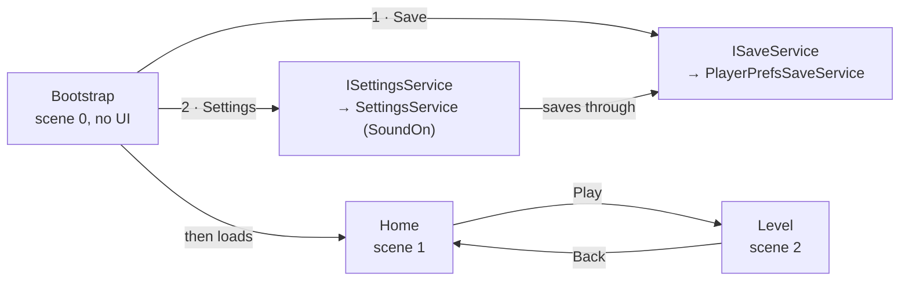

# Color Jar

**Team:** Seba Amasha · **Course:** Mobile Game Development, Shenkar

## The game in one sentence
Pour colors between jars to sort each color into its own jar, and come back every day for a daily coin reward and new jar themes to unlock.

## How to open and build
1. Open the project in Unity 6 LTS (the exact version is on Moodle).
2. File → Build Profiles → Android → Switch Platform.
3. Build and run on an Android phone.

## Repo map
| File | What it is |
|---|---|
| `pitch.md` | One-page pitch of the game |
| `DECISIONS.md` | Every real decision the team made, and why |
| `AGENTS.md` | Context for AI coding tools: architecture, rules, conventions |

## Architecture
Scenes, services and init order:

Two assemblies: **Game** (Bootstrap, ScreenFlow, CoinCounter, SoundButton, SafeAreaFitter) → **Services** (ISaveService, PlayerPrefsSaveService, ISettingsService, SettingsService, Services). Services never references Game.